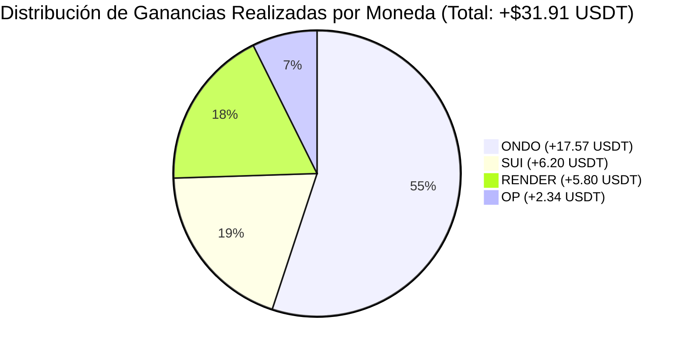

# 📊 Reporte Maestro de Ganancias Realizadas — MiCripto Sentinel
*Auditoría Cuantitativa Spot: Día, Semana, Mes, Moneda y Órdenes Individuales*

---

## 📈 1. Resumen Ejecutivo de Rendimiento

| Período | Ganancia Realizada | Operaciones Cerradas | Tasa de Acierto (Win Rate) | Capital Retornado a Cartera |
| :--- | :---: | :---: | :---: | :---: |
| **Hoy (21/10/2026)** | **+$23.92 USDT** | 3 órdenes (ONDO, SUI TP1, OP TP1) | **100%** | **$657.11 USDT** |
| **Ayer (20/10/2026)** | **+$7.99 USDT** | 2 órdenes (RENDER TP2, SUI TP0) | **100%** | **$177.76 USDT** |
| **Esta Semana (Semana 43)** | **+$31.91 USDT** | 5 órdenes cerradas | **100%** | **$834.87 USDT** |
| **Este Mes (Octubre 2026)** | **+$31.91 USDT** | 5 órdenes cerradas | **100%** | **$834.87 USDT** |
| **Histórico Acumulado a la Fecha** | **+$31.91 USDT** | 5 órdenes ejecutadas | **100%** | **$834.87 USDT** |

---

## 🪙 2. Desglose Consolidado por Moneda

| Criptomoneda | Órdenes Cobradas | Capital Total Invertido | Retorno Bruto Obtenido | Ganancia Neta (USDT) | ROI Promedio (%) |
| :--- | :---: | :---: | :---: | :---: | :---: |
| **ONDO** | 1 orden | $486.56 USDT | $504.13 USDT | **+$17.57 USDT** | `+3.61%` |
| **SUI** | 2 órdenes (TP0 + TP1) | $139.54 USDT | $145.74 USDT | **+$6.20 USDT** | `+4.44%` |
| **RENDER** | 1 orden (TP2) | $100.00 USDT | $105.80 USDT | **+$5.80 USDT** | `+5.80%` |
| **OP** | 1 orden (TP1) | $76.86 USDT | $79.20 USDT | **+$2.34 USDT** | `+3.04%` |
| **TOTALES** | **5 órdenes** | **$802.96 USDT** | **$834.87 USDT** | **+$31.91 USDT** | **`+3.97%` avg** |

---

## 📜 3. Libro Diario Detallado por Orden (Cronológico)

A continuación se detalla cada orden completada con su fecha de colocación, fecha de ejecución, precio de entrada, precio de salida, cantidad de monedas y beneficio neto:

### 🟢 21 de Octubre de 2026 (Ganancia del Día: +$23.92 USDT)

#### 1. `OP/USDT` — Take Profit 1 Defensivo
* **Orden ID:** `binance-op-sell-tp1-01320`
* **Fecha Colocada:** `21/10/2026 - 10:47:17 BOT`
* **Fecha Ejecutada:** `21/10/2026 - 14:50:00 BOT` *(Duración: 4h 3m)*
* **Cantidad Vendida:** `600.00 OP`
* **Precio de Entrada:** `$0.1281`
* **Precio de Salida (Venta):** **`$0.1320`**
* **Capital Invertido:** `$76.8600 USDT`
* **Retorno Bruto:** `$79.2000 USDT`
* **Ganancia Neta Realizada:** **`+$2.3400 USDT`** (`+3.04%`)

#### 2. `SUI/USDT` — Take Profit 1 Defensivo
* **Orden ID:** `binance-sui-sell-10540`
* **Fecha Colocada:** `19/10/2026 - 07:04:04 BOT`
* **Fecha Ejecutada:** `21/10/2026 - 14:20:00 BOT` *(Duración: 2d 7h 16m)*
* **Cantidad Vendida:** `70.00 SUI`
* **Precio de Entrada:** `$0.9967`
* **Precio de Salida (Venta):** **`$1.0540`**
* **Capital Invertido:** `$69.7690 USDT`
* **Retorno Bruto:** `$73.7800 USDT`
* **Ganancia Neta Realizada:** **`+$4.0110 USDT`** (`+5.75%`)

#### 3. `ONDO/USDT` — Take Profit Principal
* **Orden ID:** `binance-ondo-sell-04620`
* **Fecha Colocada:** `21/10/2026 - 03:11:05 BOT`
* **Fecha Ejecutada:** `21/10/2026 - 09:00:00 BOT` *(Duración: 5h 49m)*
* **Cantidad Vendida:** `1,091.20 ONDO`
* **Precio de Entrada:** `$0.4459`
* **Precio de Salida (Venta):** **`$0.4620`**
* **Capital Invertido:** `$486.5661 USDT`
* **Retorno Bruto:** `$504.1344 USDT`
* **Ganancia Neta Realizada:** **`+$17.5683 USDT`** (`+3.61%`)

---

### 🟢 20 de Octubre de 2026 (Ganancia del Día: +$7.99 USDT)

#### 4. `SUI/USDT` — Take Profit 0 Inicial
* **Orden ID:** `trade-sui-tp1-10280`
* **Fecha Colocada:** `19/10/2026 - 07:03:30 BOT`
* **Fecha Ejecutada:** `20/10/2026 - 10:30:00 BOT` *(Duración: 1d 3h 27m)*
* **Cantidad Vendida:** `70.00 SUI`
* **Precio de Entrada:** `$0.9967`
* **Precio de Salida (Venta):** **`$1.0280`**
* **Capital Invertido:** `$69.7690 USDT`
* **Retorno Bruto:** `$71.9600 USDT`
* **Ganancia Neta Realizada:** **`+$2.1910 USDT`** (`+3.14%`)

#### 5. `RENDER/USDT` — Take Profit 2 Expansivo
* **Orden ID:** `trade-render-tp2-1860`
* **Fecha Colocada:** `18/10/2026 - 15:51:08 BOT`
* **Fecha Ejecutada:** `20/10/2026 - 10:30:00 BOT` *(Duración: 1d 18h 39m)*
* **Cantidad Vendida:** `56.88 RENDER`
* **Precio de Entrada:** `$1.7580`
* **Precio de Salida (Venta):** **`$1.8600`**
* **Capital Invertido:** `$99.9950 USDT`
* **Retorno Bruto:** `$105.7968 USDT`
* **Ganancia Neta Realizada:** **`+$5.8018 USDT`** (`+5.80%`)

---

## 🎯 4. Proyección de Ganancias en Órdenes Vivas (Pendientes de Cobro)

Estas órdenes están vivas y activas en Binance Spot vigiladas por MiCripto Sentinel:

| Moneda / Orden | Precio Venta | Cantidad Monedas | Monto a Recibir | Ganancia Neta Proyectada |
| :--- | :---: | :---: | :---: | :---: |
| **OP (TP2 Expansivo)** | `$0.1352` | 727.08 OP | $98.30 USDT | **+$5.16 USDT** |
| **SUI (TP2 Expansivo)** | `$1.0650` | 149.70 SUI | $159.43 USDT | **+$9.43 USDT** |
| **SUBTOTAL EN VENTAS** | — | — | **$257.73 USDT** | **+$14.59 USDT** |

*Al ejecutarse estas 2 órdenes vivas restantes, el acumulado histórico alcanzará **+$46.50 USDT netos**.*
